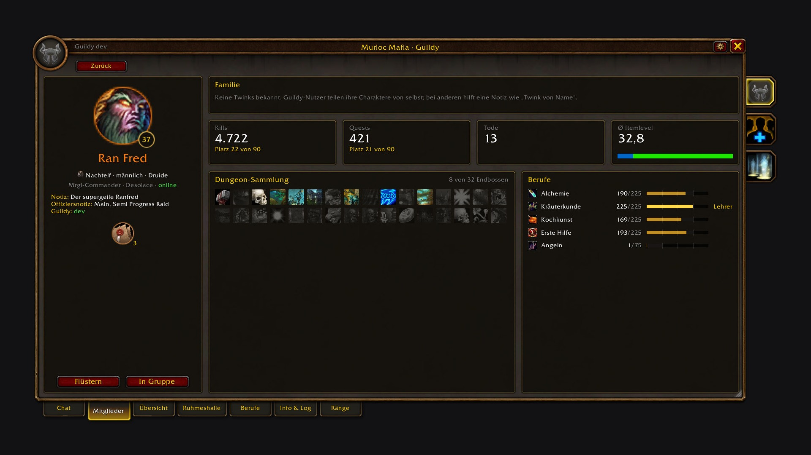
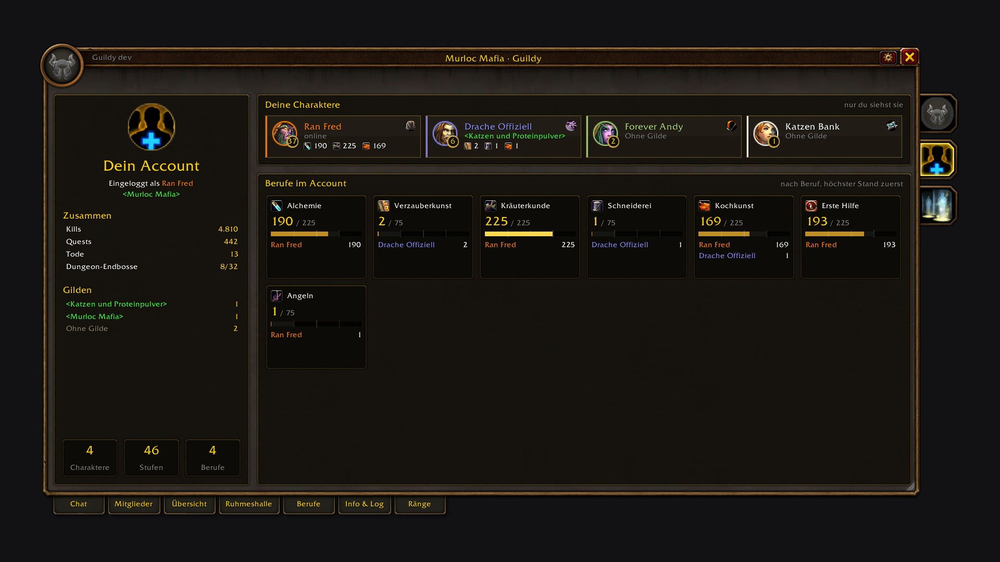
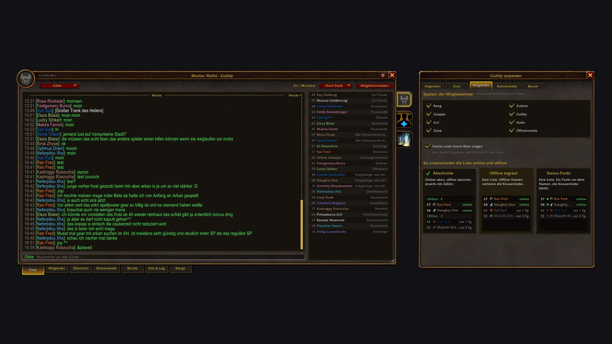

# Guildy

On WoW Forever I almost never opened the guild window. It has a chat and a plain list, and I rarely needed either. Guildy is what I built to change that. Press **J** and you land in the guild chat, with tabs next to it for the members, a census of who is still active, professions with a recipe search, and guild records taken from Forever's character statistics.

It runs inside Blizzard's own guild window and keeps Blizzard's look. I use it every day in my own guild.

Made for WoW Forever. English and German.

## What's in it

- The chat is what J opens. It shows the newest lines and loads older ones as you scroll up, with times, a timeline of the days and a mark for what is new since your last login. The text is a little larger than Blizzard's. Officer chat is one click away, and joins and leaves appear as lines in the chat.
- Next to the chat is the list of everyone online, with level, class colour, professions and zone. Hover a name for rank, notes and skills. A click opens the character page, shift-click whispers, and a right click opens Blizzard's member menu, which Guildy extends with "Copy character name".
- The members tab searches names, zones and notes, filters by class, level bracket and profession, and sorts by any column. Online and offline members can sit in two sections, twinks can hang under their main, and you choose which columns you want to see.
- The overview is a census of the guild: classes, levels and professions of the members who were online in the last month, three months, six months, or ever. Click a bar to see who is behind it.
- Professions lists every profession with how many members have it and how many of them are online. Pick one to see its members with skill, recipes and where the data comes from, and browse a member's recipes right next to it. The search answers "who can make Elixir of Lion's Strength?".
- Character pages show a member's twinks, dungeons, gear and professions.
- The account tab shows your own characters and all their professions together.
- Info & log has the message of the day, the guild information and the guild log.
- Communities is a side tab with your communities, their chat and their members. You can accept invitations, join from invite links, create a community and invite members, and Blizzard's own right-click menus work there (leave, notifications, favorites, member notes). It works without a guild too.
- The cog in the title bar opens the options next to the window, so you see a change while you make it: how the member list shows who is online, its columns, which tiles and title cards the Hall of Fame shows, where tooltips appear, and whether the chat shows profession icons.

## Where the profession data comes from

An addon can only read its own character directly, so Guildy collects the rest from several places:

- Your own characters. Open each profession window once and Guildy knows your skill and recipes.
- Other Guildy users. Everyone with Guildy shares their professions on the guild's addon channel, gathering skills included. Sending is throttled so nobody lags, and you can switch your own sharing off.
- The recipe books of online members. One button in the professions tab opens them one after another and stores what it finds, while Blizzard's window stays hidden. This reaches members who are online and on your server shard, because books of other shards don't open on Forever.
- Profession links. Click someone's profession link in chat and Guildy remembers their recipes.
- Guild notes. Notes like "Herb/Alch" or "Tank Schmied" count too and are marked "from note". Real data always replaces them.

## Inviting and managing

"inv pls"? The invite button opens Blizzard's own invite dialog with your target filled in and suggests the last people who whispered you.

On Forever, guild management is reserved for Blizzard's own code, and most addons can't touch it. Guildy lives inside Blizzard's guild window and lays Blizzard's frames under its own controls, so it still works from Guildy's window. Removing a member is on the character page and in the member menu. The message of the day and the guild info are edited in the info tab, where you type into Blizzard's own edit box. The ranks tab lists every rank with its members and permissions, and the guild master edits them there in Blizzard's rank editor, which opens inside the tab. For rank and notes, a member's character page shows Blizzard's member panel next to Guildy: pick a rank there, or click a note and Blizzard's note dialog opens.

## Hall of Fame

Forever records statistics for every character: creatures killed, quests, deaths (including by Hogger), gold, auctions, dungeon bosses and more. The Hall of Fame turns them into five pages, for all time, this month or last month:

- General has the guild totals with mounts and pets, title cards for the top members and the equipment of Guildy users.
- Economy shows where the gold comes from and where it goes.
- Dungeons covers end bosses and dungeon progress.
- Reputation lists the factions per standing.
- PvP counts honorable kills, duels won and lost, and battlegrounds.

Click any value for the guild ranking. Guildy reads your own statistics and asks the game for those of guild members you target or hover nearby, who don't need Guildy for that. Guildy users share what they have with each other, so the pages fill up faster the more members use it.

## Commands

- `/guildy`: close the window (it opens with **J** or the guild button of the micro menu)
- `/guildy sync`: send your profession summary to the guild
- `/guildy debug`: what Guildy knows about your professions and how the last reads went
- `/guildy perf on`, then `/guildy perf`: measure how long Guildy's own code runs. If Guildy stutters for you, this report is the most useful thing to attach to an issue.

## Getting started

1. Install it with the [CurseForge](https://www.curseforge.com/wow/addons/guildy) app or drop it into `Interface/AddOns`.
2. Press **J**.
3. Open each of your profession windows once.

J, the micro menu and Escape work as before. If you disable Guildy, you get Blizzard's window back as it was.

## Feedback

Bugs and wishes go to the [issues](https://github.com/svengabr/Guildy/issues). I read all of them, and I'm especially glad to hear from officers of bigger guilds, because my own guild has about a hundred members and I can't test every size myself.

## Deutsch

Auf WoW Forever habe ich das Gildenfenster fast nie geöffnet. Ein Chat und eine schlichte Liste, beides habe ich selten gebraucht. Guildy habe ich gebaut, um das zu ändern. **J** öffnet den Gildenchat, und daneben gibt es Reiter für die Mitglieder, einen Census der aktiven Mitglieder, Berufe mit Rezeptsuche und Gildenrekorde aus den Charakter-Statistiken von Forever.

Guildy läuft in Blizzards eigenem Gildenfenster und behält dessen Optik. Ich nutze es jeden Tag in meiner eigenen Gilde.

Die Reiter:

- Der Chat zeigt die neuesten Zeilen und lädt ältere beim Hochscrollen nach, mit Uhrzeiten, einer Zeitleiste der Tage und einer Markierung „neu seit deinem letzten Login“. Die Schrift ist etwas größer, der Offizierschat ist einen Klick entfernt, Beitritte stehen als graue Zeile im Chat. Daneben siehst du alle Online-Mitglieder mit Stufe, Klassenfarbe, Berufen und Zone. Ein Klick öffnet die Charakterseite, Shift-Klick flüstert an, Rechtsklick öffnet Blizzards Mitgliedermenü, das Guildy um „Charakternamen kopieren“ ergänzt.
- Mitglieder: Suche nach Name, Zone oder Notiz, Filter für Klasse, Stufe und Beruf, sortierbare Spalten. Online und Offline können in zwei Abschnitten stehen, Twinks unter ihrem Main, und die Spalten wählst du selbst.
- Die Übersicht ist der Census eurer Gilde: Klassen, Stufen und Berufe der Mitglieder, die im letzten Monat, in den letzten drei oder sechs Monaten oder überhaupt online waren. Ein Klick auf einen Balken zeigt, wer dahintersteckt.
- Berufe: links alle Berufe mit der Zahl der Mitglieder und wie viele davon online sind. Ein Klick zeigt die Mitglieder des Berufs mit Skill, Rezepten und Datenquelle, daneben die Rezepte des gewählten Mitglieds. Die Suche findet, wer ein Rezept oder einen Gegenstand herstellen kann.
- Charakterseiten zeigen Twinks, Dungeons, Ausrüstung und Berufe eines Mitglieds, der Account-Reiter deine eigenen Charaktere mit allen Berufen.
- Info & Log: Nachricht des Tages, Gildeninformation und Gildenlog.
- Communitys ist ein Seitenreiter mit deinen Communitys, ihrem Chat und ihren Mitgliedern. Einladungen annehmen, über Einladungslinks beitreten, eine Community gründen und Mitglieder einladen geht dort, auch ohne Gilde.
- Das Zahnrad in der Titelleiste öffnet die Optionen neben dem Fenster: Darstellung und Spalten der Mitgliederliste, Kacheln und Titel-Karten der Ruhmeshalle, Position der Tooltips, Berufssymbole im Chat.

Woher die Berufe kommen: aus deinen eigenen Berufsfenstern (einmal öffnen reicht), von anderen Guildy-Nutzern (auch Sammelberufe, abschaltbar), aus angeklickten Berufslinks, aus Gildennotizen wie „Herb/Alch“ und über den Knopf „Online-Mitglieder einlesen“. Der öffnet nacheinander die Rezeptbücher aller Online-Mitglieder deines Server-Bereichs und merkt sich die Rezepte.

Die Ruhmeshalle: Forever führt Statistiken pro Charakter, etwa getötete Kreaturen, Quests, Tode (auch durch Hogger), Gold, Auktionen und Dungeon-Bosse. Die Ruhmeshalle macht daraus fünf Seiten, gesamt, für diesen oder den letzten Monat: Allgemein, Wirtschaft, Dungeons, Ruf und PvP. Ein Klick auf einen Wert zeigt die Rangliste der Gilde. Guildy liest deine eigenen Werte und fragt die von Gildenmitgliedern in der Nähe ab, die du ins Ziel nimmst oder mit der Maus überfährst. Die brauchen dafür kein Guildy. Guildy-Nutzer teilen ihre Werte untereinander.

Einladen und Verwalten: „Mitglied einladen“ öffnet Blizzards Einladen-Dialog mit deinem Ziel schon eingetragen und schlägt vor, wer dich zuletzt angeflüstert hat. Gildenverwaltung ist auf Forever Blizzards eigenem Code vorbehalten. Guildy sitzt in Blizzards Gildenfenster und legt dessen Bedienelemente unter die eigenen, deshalb geht es trotzdem: Entfernen auf der Charakterseite und im Mitgliedermenü, Nachricht des Tages und Gildeninfo im Info-Reiter, Ränge und Rechte im Reiter Ränge in Blizzards eigenem Rang-Editor, Rang und Notizen auf der Charakterseite über Blizzards Mitglieder-Fenster.

Befehle: `/guildy` schließt das Fenster (geöffnet wird es mit **J** oder dem Gilden-Knopf im Mikromenü), `/guildy sync` schickt deine Berufsübersicht an die Gilde, `/guildy debug` zeigt, was Guildy über deine Berufe weiß. Mit `/guildy perf on` und danach `/guildy perf` misst Guildy, wie lange sein eigener Code läuft. Wenn es bei dir ruckelt, hilft mir dieser Bericht am meisten.

Unterstützen: Guildy ist kostenlos und bleibt es. Wenn es dir das Spiel ein bisschen leichter macht, kannst du mir [einen Kaffee ausgeben](https://buymeacoffee.com/conoar) oder etwas über [PayPal](https://paypal.me/svengabr) schicken.

## Support

Guildy is free and stays free. If it made your game a bit nicer, you can [buy me a coffee](https://buymeacoffee.com/conoar) or send something via [PayPal](https://paypal.me/svengabr).

## License

GPL-3.0-or-later

- Download: https://www.curseforge.com/wow/addons/guildy
- Source and issues: https://github.com/svengabr/Guildy
