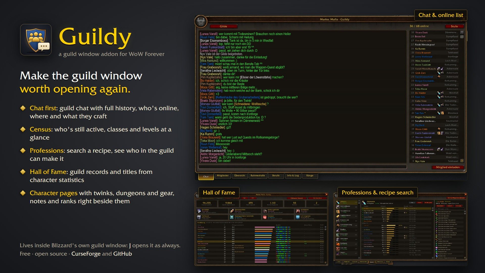
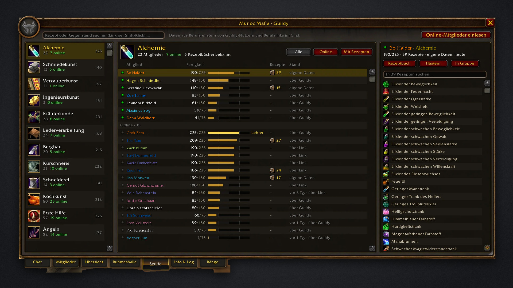
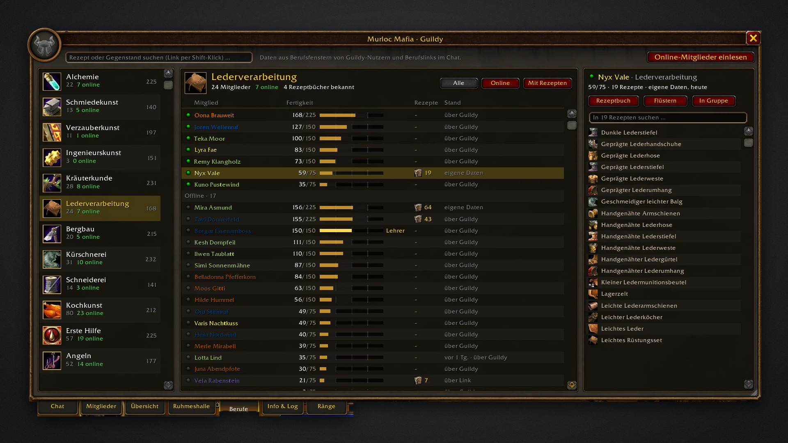
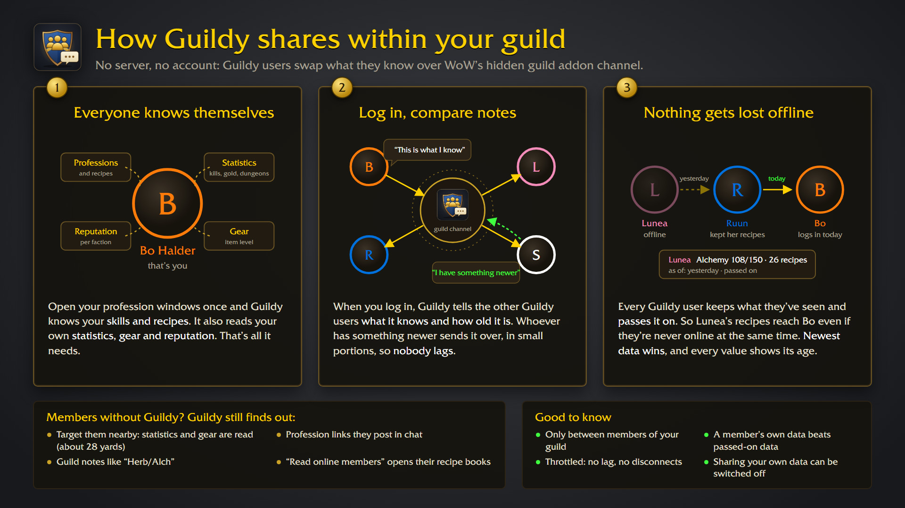
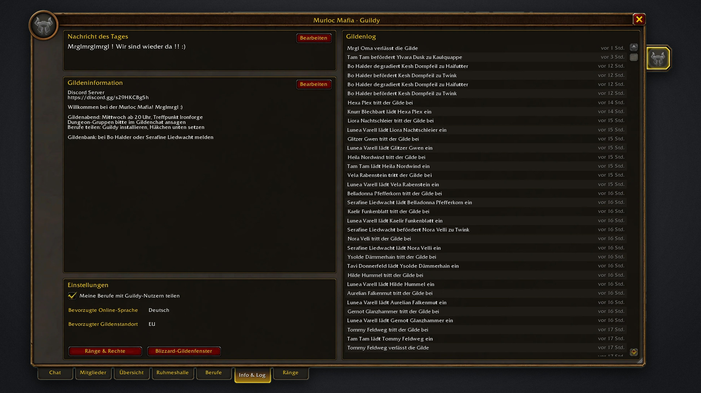
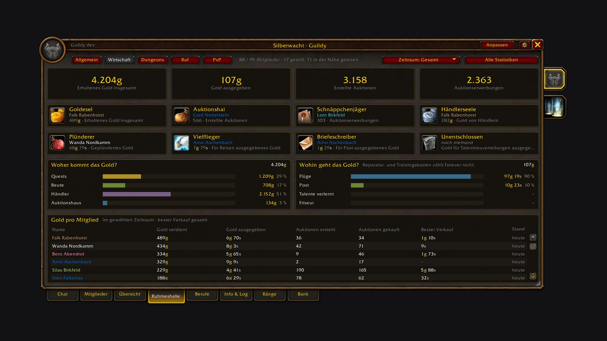
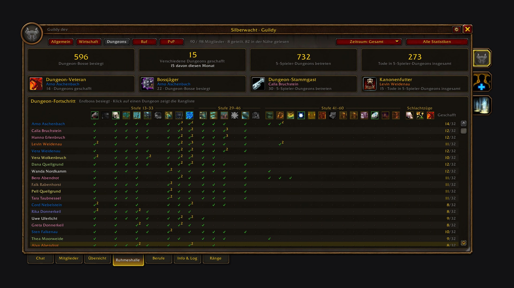
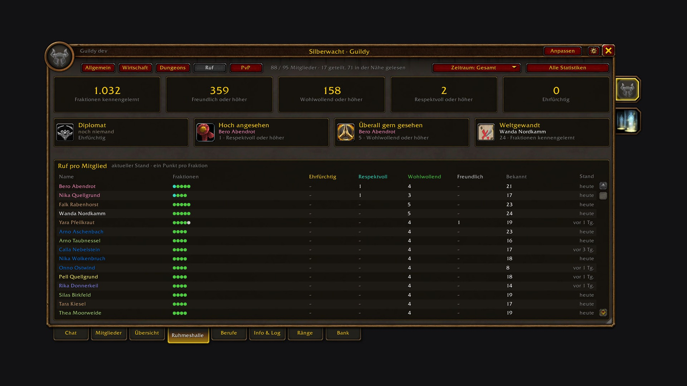
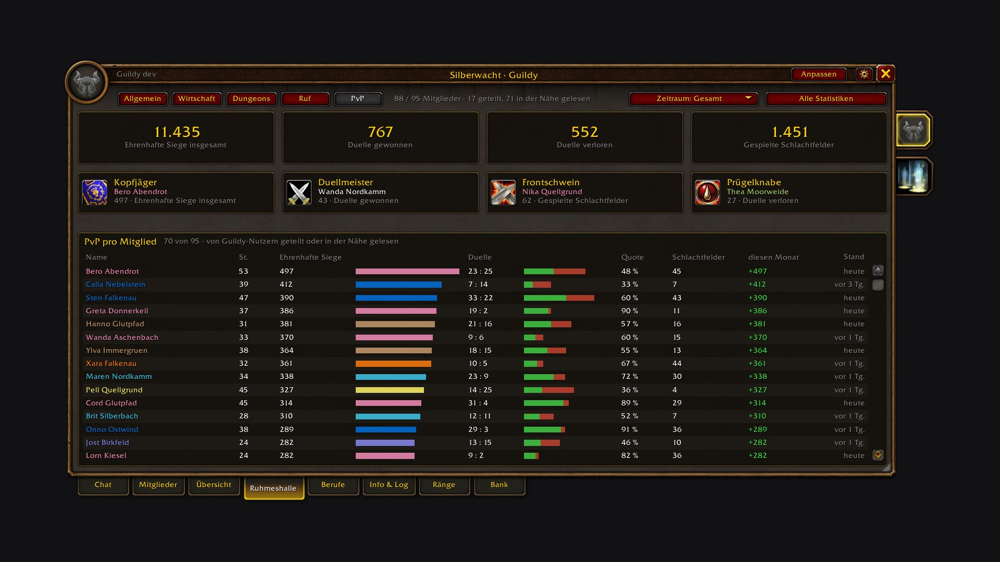

# Guildy

The default guild window shows a chat and a plain list. Guildy makes it worth opening again: it shows your guild at a glance, who's online and where, who's still active, what classes and levels you have, and who can craft what. Press **J** and it opens on the guild chat, in Blizzard's look, right inside Blizzard's own guild window.

Made for **WoW Forever**.

## What it does

- **Chat first**: J always opens on the guild chat, with the whole history, times, a timeline of the days and a mark for what's new since your last login, a bit larger text and an input line. Officer chat is one click away. Join and leave messages show up in the chat.
- **Who's online**: next to the chat, every online member with level, class colour, professions and zone. Hover for rank, notes and skills, click for the character page, shift-click to whisper, right-click for Blizzard's member menu (with "Copy character name").
- **Members**: search name, zone or note, filter by class, level bracket and profession, sort by any column. The details panel shows notes, rank, last online and professions.
- **Overview**: the census of your guild. Classes, levels and professions of the members who were online in the last month, three months, six months, or all of them. Click a bar to see who it is.
- **Professions**: every profession in a list on the left, with how many members have it and how many are online. Pick one to see its members with skill, recipes and where the data comes from; filter by online or by members with recipes, and browse a member's recipes right next to it. The search finds who can craft a recipe or item ("who can make Elixir of Lion's Strength?").
- **Info & Log**: message of the day, guild information and the guild log.

## Where the profession data comes from

- **Your own characters**: open each profession window once and Guildy knows your skill and recipes.
- **Other Guildy users**: everyone with Guildy shares their professions on the guild addon channel, gathering skills included. It's throttled, so nobody lags. You can switch your own sharing off.
- **Read online members**: one button in the Professions tab opens the recipe book of every online member one after another and stores what it finds. Blizzard's window stays hidden while it runs. It works for members who are online and on your server shard (books of other shards don't open on Forever).
- **Profession links**: click someone's profession link in chat and Guildy remembers their recipes.
- **Guild notes**: notes like "Herb/Alch" or "Tank Schmied" count too, marked "from note". Real data always wins.

## Inviting and managing

"inv pls"? **Invite member** opens Blizzard's own invite dialog with your target filled in, and suggests the last people who whispered you.

On Forever, guild management is reserved for Blizzard's own code. Guildy still does it from its own window: **Remove** sits on the character page and in the member menu, and the message of the day and guild info are edited right in the Info tab. Behind the scenes these run through Blizzard's own secure commands, and you type into Blizzard's own edit box, shown right inside Guildy. The **Ranks** tab lists every rank with its members and permissions; the guild master edits ranks and permissions there in Blizzard's own rank editor, opened right inside the tab. For rank and notes, a member's character page shows Blizzard's own member panel next to Guildy, in Guildy's look: pick a rank there, or click a note and Blizzard's note dialog opens. Guildy lives inside Blizzard's guild window (it is drawn on top of it), so all of Blizzard's guild buttons are right underneath Guildy's.

## Hall of Fame

Forever records character statistics: creatures killed, quests, deaths (including by Hogger), gold, auctions, dungeon bosses and more. The **Hall of Fame** tab turns them into five pages, for all time, this month or last month: General (guild totals with mounts and pets, title cards and the equipment of Guildy users), Economy (where the gold comes from and where it goes) Dungeons (end bosses and dungeon progress) Reputation (factions per standing) and PvP (honorable kills, duels won and lost, battlegrounds); click any of them for the guild ranking. Addons can only read their own character's statistics directly, so Guildy reads yours, asks the game for those of guild members you target and shares them with other Guildy users. The more members use Guildy, the more complete it gets.

## Commands

- `/guildy`: close the window (it opens with **J** or the guild button of the micro menu)
- `/guildy sync`: send your profession summary to the guild
- `/guildy debug`: what Guildy knows about your professions and how the last reads went

## Getting started

1. Install it via the [CurseForge](https://www.curseforge.com/wow/addons/guildy) app or drop it into `Interface/AddOns`.
2. Press **J**.
3. Open each of your profession windows once.

That's it. Guildy sits inside Blizzard's own guild window: J, the micro menu and Escape work as always, and disabling Guildy gives you Blizzard's window back as it was.

---

## Deutsch

Das Standard-Gildenfenster zeigt einen Chat und eine schlichte Liste. Guildy macht es wieder interessant: deine Gilde auf einen Blick, wer online ist und wo, wer noch aktiv ist, welche Klassen und Stufen ihr habt und wer was herstellen kann. **J** öffnet es immer im Gildenchat, im Blizzard-Stil, direkt in Blizzards eigenem Gildenfenster. Gemacht für **WoW Forever**.

**Die Reiter:**

- **Chat**: Gildenchat mit ganzem Verlauf, Uhrzeiten, Zeitleiste und Markierung „neu seit deinem letzten Login“, etwas größerer Schrift, Offizierschat mit einem Klick, Beitritte als graue Zeile. Daneben alle Online-Mitglieder mit Stufe, Klassenfarbe, Berufen und Zone. Klick öffnet die Charakterseite, Shift-Klick flüstert an, Rechtsklick öffnet Blizzards Mitgliedermenü (mit „Charakternamen kopieren“).
- **Mitglieder**: Suche nach Name, Zone oder Notiz, Filter für Klasse, Stufe und Beruf, sortierbare Spalten und eine Detailansicht.
- **Übersicht**: der Census eurer Gilde. Klassen, Stufen und Berufe der Mitglieder, die im letzten Monat, in den letzten drei oder sechs Monaten oder überhaupt online waren. Ein Klick auf einen Balken zeigt, wer es ist.
- **Berufe**: links alle Berufe mit der Zahl der Mitglieder und wie viele davon online sind. Ein Klick zeigt die Mitglieder des Berufs mit Skill, Rezepten und Datenquelle, filterbar nach online oder mit Rezepten, und daneben die Rezepte des gewählten Mitglieds. Die Suche findet, wer ein Rezept oder einen Gegenstand herstellen kann („wer kann mir das herstellen?“).
- **Info & Log**: Nachricht des Tages, Gildeninformation und Gildenlog.

**Woher die Berufe kommen:** aus deinen eigenen Berufsfenstern (einmal öffnen reicht), automatisch von anderen Guildy-Nutzern (inklusive Sammelberufe, abschaltbar), aus angeklickten Berufslinks, aus Gildennotizen wie „Herb/Alch“ und per Knopf „Online-Mitglieder einlesen“. Der öffnet nacheinander die Rezeptbücher aller Online-Mitglieder deines Server-Bereichs und merkt sich die Rezepte.

**Ruhmeshalle:** Forever führt Statistiken pro Charakter: getötete Kreaturen, Quests, Tode (auch durch Hogger), Gold, Auktionen, Dungeon-Bosse und mehr. Der Tab **Ruhmeshalle** macht daraus fünf Seiten, gesamt, für diesen oder den letzten Monat: Allgemein (Gildensummen mit Reittieren und Haustieren, Titel-Karten und die Ausrüstung der Guildy-Nutzer), Wirtschaft (woher das Gold kommt und wohin es geht) Dungeons (Endbosse und Dungeon-Fortschritt) Ruf (Fraktionen je Rufstufe) und PvP (ehrenhafte Siege, gewonnene und verlorene Duelle, Schlachtfelder); ein Klick zeigt die Rangliste der Gilde. Addons lesen direkt nur die Werte des eigenen Charakters, deshalb liest Guildy deine, fragt die von Gildenmitgliedern ab, die du ins Ziel nimmst und teilt sie mit anderen Guildy-Nutzern.

**Einladen und Verwalten:** „Mitglied einladen“ öffnet Blizzards Einladen-Dialog mit deinem Ziel schon eingetragen und schlägt vor, wer dich zuletzt angeflüstert hat. Entfernen geht auf der Charakterseite und im Mitgliedermenü, Nachricht des Tages und Gildeninfo bearbeitest du im Info-Tab. Guildy nutzt dafür Blizzards eigene sichere Befehle, und du tippst in Blizzards eigenes Eingabefeld, das Guildy im Info-Tab anzeigt. Der Tab **Ränge** zeigt alle Ränge mit Mitgliedern und Rechten; der Gildenmeister bearbeitet Ränge und Rechte dort in Blizzards eigenem Rang-Editor, der direkt im Tab aufgeht. Für Rang und Notizen zeigt die Charakterseite Blizzards eigenes Mitglieder-Fenster neben Guildy, in Guildys Optik: dort den Rang wählen oder auf eine Notiz klicken, und Blizzards Notiz-Dialog öffnet sich. Guildy lebt in Blizzards Gildenfenster (es liegt obenauf), deshalb liegen Blizzards Gilden-Knöpfe direkt unter Guildys.

**Befehle:** `/guildy` schließt das Fenster (geöffnet wird es mit **J** oder dem Gilden-Knopf im Mikromenü), `/guildy sync` schickt deine Berufsübersicht an die Gilde, `/guildy debug` zeigt, was Guildy über deine Berufe weiß.

**Unterstützen:** Guildy ist kostenlos und bleibt es auch. Wenn es dir das Spiel ein bisschen leichter macht, kannst du mir [einen Kaffee ausgeben](https://buymeacoffee.com/conoar) oder etwas über [PayPal](https://paypal.me/svengabr) schicken.

## Support

Guildy is free and always will be. If it made your game a bit nicer, you can [buy me a coffee](https://buymeacoffee.com/conoar) or send something via [PayPal](https://paypal.me/svengabr).

## License

GPL-3.0-or-later · Download: https://www.curseforge.com/wow/addons/guildy · Source & issues: https://github.com/svengabr/Guildy
