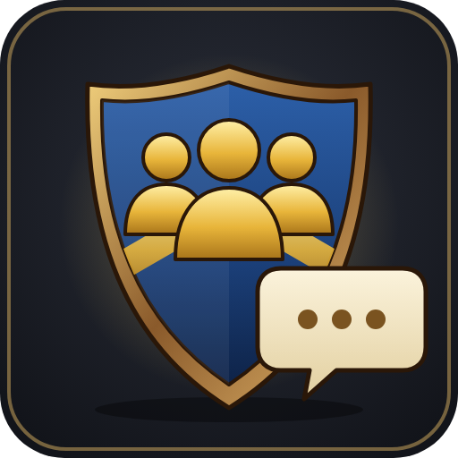
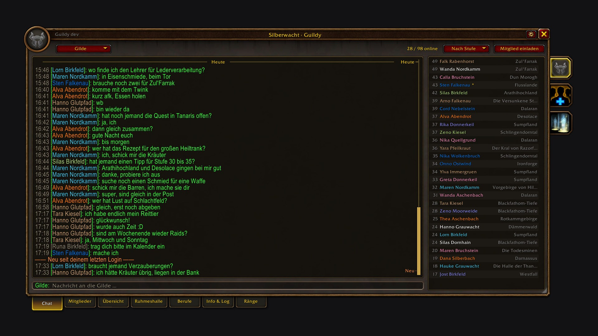
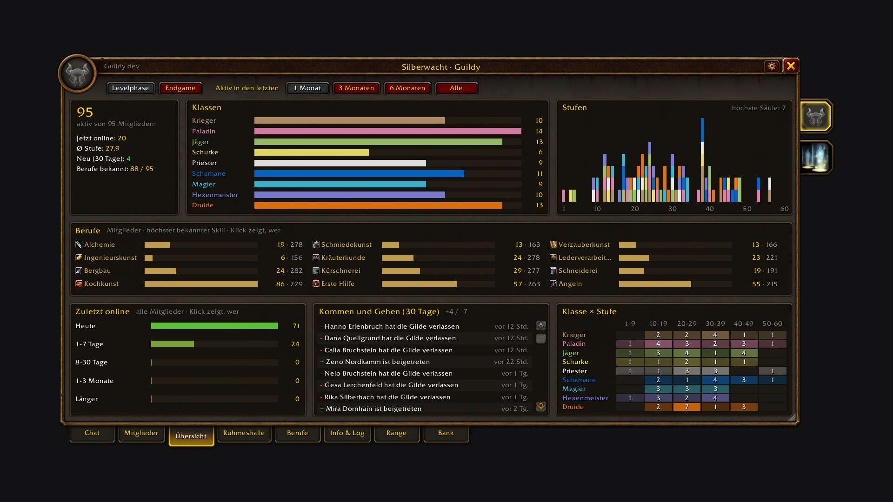
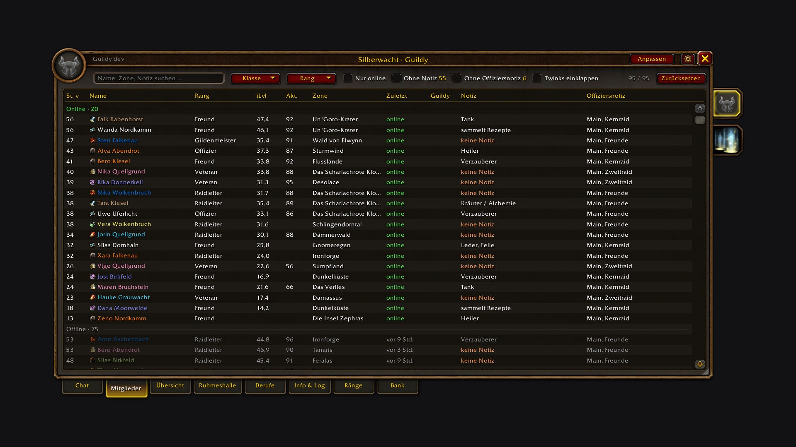
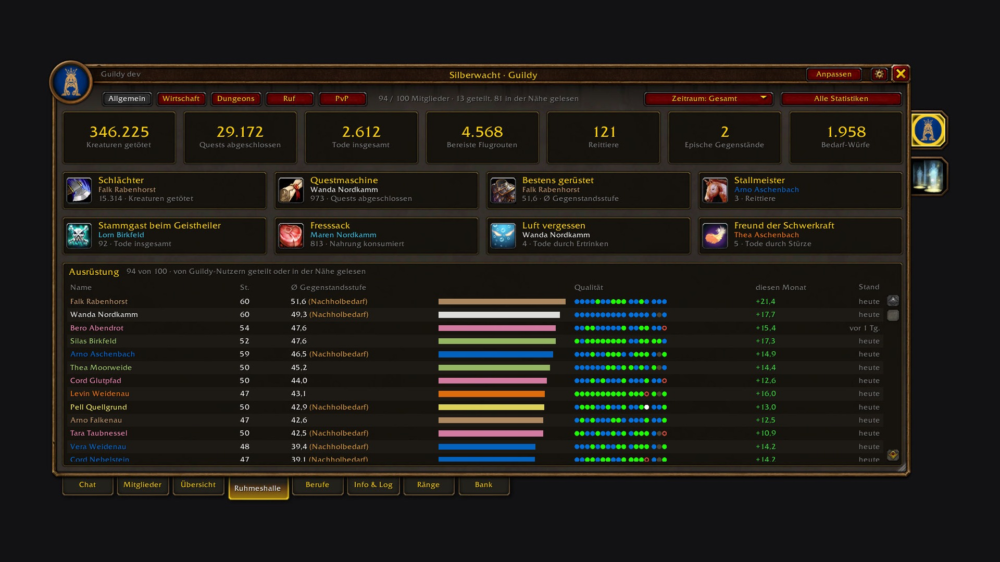

# Guildy

The default guild window shows a chat and a plain list. Guildy replaces it with a window that shows your guild at a glance: who's online and where, who's still active, what classes and levels you have, and who can craft what. Press **J** and it opens on the guild chat, in Blizzard's look.

Made for **WoW Forever**.

## What it does

- **Chat first**: J always opens on the guild chat, with history, a bit larger text and an input line. Officer chat is one click away. Join and leave messages show up in the chat.
- **Who's online**: next to the chat, every online member with level, class colour, professions and zone. Hover for rank, notes and skills, click to whisper, right-click for the menu.
- **Members**: search name, zone or note, filter by class, level bracket and profession, sort by any column. The details panel shows notes, rank, last online and professions.
- **Overview**: the census of your guild. Classes, levels and professions of the members who were online in the last month, three months, six months, or all of them. Click a bar to see who it is.
- **Professions**: who has which profession at what skill, and a recipe search ("who can make Elixir of Lion's Strength?"). Click a member to expand their recipes, or open their recipe book.
- **Info & Log**: message of the day, guild information and the guild log.

## Where the profession data comes from

- **Your own characters**: open each profession window once and Guildy knows your skill and recipes.
- **Other Guildy users**: everyone with Guildy shares their professions on the guild addon channel, gathering skills included. It's throttled, so nobody lags. You can switch your own sharing off.
- **Read online members**: one button in the Professions tab opens the recipe book of every online member one after another and stores what it finds. Blizzard's window stays hidden while it runs. It works for members who are online and on your server shard (books of other shards don't open on Forever).
- **Profession links**: click someone's profession link in chat and Guildy remembers their recipes.
- **Guild notes**: notes like "Herb/Alch" or "Tank Schmied" count too, marked "from note". Real data always wins.

## Inviting and managing

"inv pls"? **Invite member** opens Blizzard's own invite dialog with your target filled in, and suggests the last people who whispered you.

On Forever, guild management is reserved for Blizzard's own code. Guildy still does it from its own window: **Promote**, **Demote** and **Remove** sit in the member details and the member menu, and the message of the day and guild info are edited right in the Info tab. Behind the scenes these run through Blizzard's own secure commands, and you type into Blizzard's own edit box, shown right inside Guildy. The **Ranks** tab lists every rank with its members and permissions; the guild master edits ranks and permissions there in Blizzard's own rank editor, opened right inside the tab. Only notes still open Blizzard's guild window: Blizzard saves a note only for the member picked in its own list. The very first J of a session briefly opens and closes Blizzard's guild window in the background, so invite and editing work right away.

## Hall of Fame

Forever records character statistics: creatures killed, quests, deaths (including by Hogger), gold, auctions, dungeon bosses and more. The **Hall of Fame** tab turns them into guild totals, title cards and dungeon progress, for all time, this month or last month; click any of them for the guild ranking. Addons can only read their own character's statistics directly, so Guildy reads yours, asks the game for those of guild members you target and shares them with other Guildy users. The more members use Guildy, the more complete it gets.

## Commands

- `/guildy`: open or close the window
- `/guildy sync`: send your profession summary to the guild
- `/guildy debug`: what Guildy knows about your professions and how the last reads went

## Getting started

1. Install it via the [CurseForge](https://www.curseforge.com/wow/addons/guildy) app or drop it into `Interface/AddOns`.
2. Press **J**.
3. Open each of your profession windows once.

That's it. J gives you the guild window back as soon as Guildy is disabled: it only adds a temporary key binding and never touches Blizzard's code.

---

## Deutsch

Das Standard-Gildenfenster zeigt einen Chat und eine schlichte Liste. Guildy ersetzt es durch ein Fenster, das deine Gilde auf einen Blick zeigt: wer online ist und wo, wer noch aktiv ist, welche Klassen und Stufen ihr habt und wer was herstellen kann. **J** öffnet es immer im Gildenchat, im Blizzard-Stil. Gemacht für **WoW Forever**.

**Die Reiter:**

- **Chat**: Gildenchat mit Verlauf und etwas größerer Schrift, Offizierschat mit einem Klick, Beitritte als graue Zeile. Daneben alle Online-Mitglieder mit Stufe, Klassenfarbe, Berufen und Zone. Klick flüstert an, Rechtsklick öffnet das Menü.
- **Mitglieder**: Suche nach Name, Zone oder Notiz, Filter für Klasse, Stufe und Beruf, sortierbare Spalten und eine Detailansicht.
- **Übersicht**: der Census eurer Gilde. Klassen, Stufen und Berufe der Mitglieder, die im letzten Monat, in den letzten drei oder sechs Monaten oder überhaupt online waren. Ein Klick auf einen Balken zeigt, wer es ist.
- **Berufe**: wer welchen Beruf mit welchem Skill hat, und eine Rezeptsuche („wer kann mir das herstellen?“). Ein Klick klappt die Rezepte eines Mitglieds auf, per Rechtsklick öffnest du sein Rezeptbuch.
- **Info & Log**: Nachricht des Tages, Gildeninformation und Gildenlog.

**Woher die Berufe kommen:** aus deinen eigenen Berufsfenstern (einmal öffnen reicht), automatisch von anderen Guildy-Nutzern (inklusive Sammelberufe, abschaltbar), aus angeklickten Berufslinks, aus Gildennotizen wie „Herb/Alch“ und per Knopf „Online-Mitglieder einlesen“. Der öffnet nacheinander die Rezeptbücher aller Online-Mitglieder deines Server-Bereichs und merkt sich die Rezepte.

**Ruhmeshalle:** Forever führt Statistiken pro Charakter: getötete Kreaturen, Quests, Tode (auch durch Hogger), Gold, Auktionen, Dungeon-Bosse und mehr. Der Tab **Ruhmeshalle** macht daraus Gildensummen, Titel-Karten und den Dungeon-Fortschritt, gesamt, für diesen oder den letzten Monat; ein Klick zeigt die Rangliste der Gilde. Addons lesen direkt nur die Werte des eigenen Charakters, deshalb liest Guildy deine, fragt die von Gildenmitgliedern ab, die du ins Ziel nimmst und teilt sie mit anderen Guildy-Nutzern.

**Einladen und Verwalten:** „Mitglied einladen“ öffnet Blizzards Einladen-Dialog mit deinem Ziel schon eingetragen und schlägt vor, wer dich zuletzt angeflüstert hat. Befördern, Degradieren und Entfernen gehen direkt in den Mitgliederdetails und im Mitgliedermenü, Nachricht des Tages und Gildeninfo bearbeitest du im Info-Tab. Guildy nutzt dafür Blizzards eigene sichere Befehle, und du tippst in Blizzards eigenes Eingabefeld, das Guildy im Info-Tab anzeigt. Der Tab **Ränge** zeigt alle Ränge mit Mitgliedern und Rechten; der Gildenmeister bearbeitet Ränge und Rechte dort in Blizzards eigenem Rang-Editor, der direkt im Tab aufgeht. Nur Notizen öffnen noch das Blizzard-Gildenfenster: Blizzard speichert eine Notiz nur für das Mitglied, das in seiner eigenen Liste ausgewählt ist. Das erste J einer Sitzung öffnet Blizzards Gildenfenster dafür einmal kurz im Hintergrund.

**Befehle:** `/guildy` öffnet und schließt das Fenster, `/guildy sync` schickt deine Berufsübersicht an die Gilde, `/guildy debug` zeigt, was Guildy über deine Berufe weiß.

**Unterstützen:** Guildy ist kostenlos und bleibt es auch. Wenn es dir das Spiel ein bisschen leichter macht, kannst du mir [einen Kaffee ausgeben](https://buymeacoffee.com/conoar).

## Support

Guildy is free and always will be. If it made your game a bit nicer, you can [buy me a coffee](https://buymeacoffee.com/conoar).

## License

GPL-3.0-or-later · Download: https://www.curseforge.com/wow/addons/guildy · Source & issues: https://github.com/svengabr/Guildy
